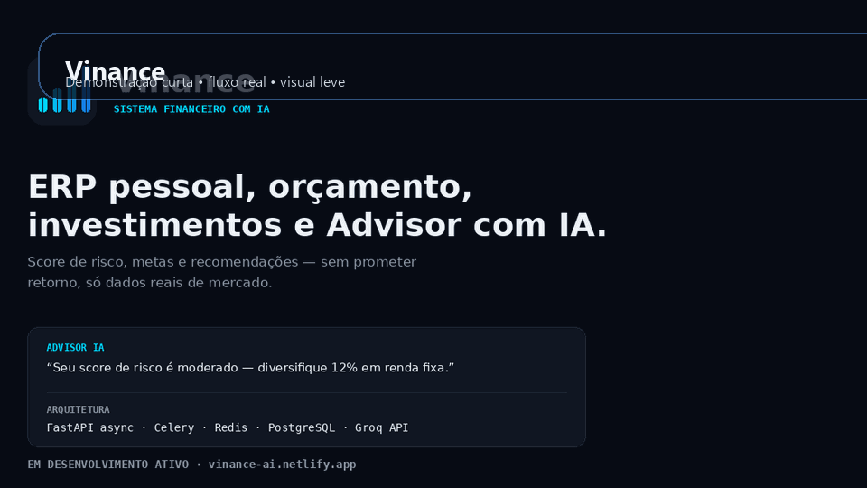

# Vinance

**For recruiters:** [Technical case study — English / Español](docs/RECRUITER_CASE_STUDY.md)


Sistema operacional financeiro com IA, ERP, orcamento, investimentos e copiloto financeiro inteligente.

O frontend oficial e React + Vite + TypeScript em `frontend/`. O Streamlit foi preservado apenas como admin legado e apoio operacional.


## English overview

**Vinance** is a full-stack financial operations and analytics application. It combines **FastAPI, PostgreSQL, Redis, Celery, React, TypeScript and Docker** to organize financial records, generate analytical views and support budget and investment workflows.

**Architecture highlights:** the React frontend lives in `frontend/`, REST services and financial domain modules in `backend/app/`, and background processing in `workers/`. Streamlit is retained as a legacy administrative tool rather than the primary user interface.

- [Architecture and technical docs](docs/architecture.md) · [Security](docs/SECURITY.md) · [Multi-tenancy](docs/MULTI_TENANCY.md)
- [Continuous integration](https://github.com/vinmedrado/vinance/actions/workflows/ci.yml)

> This is a software engineering portfolio project. Automated checks are not a claim of financial advice certification or a complete production security review.

## Visao geral

Vinance organiza dados financeiros pessoais e transforma esses dados em diagnostico, planejamento, alertas, recomendacoes e leitura executiva da carteira.

## Problema que resolve

- Controle financeiro disperso entre planilhas e aplicativos isolados.
- Dificuldade para entender capacidade real de aporte.
- Falta de um fluxo unico entre orcamento, metas e investimentos.
- Necessidade de contextualizar a informacao para o usuario final.

## Arquitetura

```text
frontend/        frontend principal SaaS
backend/app/     API FastAPI
backend/app/erp/ ERP financeiro
backend/app/financial/ diagnostico e consultoria
backend/app/market/ mercado, ranking e oportunidades
backend/app/backtest/ backtests
legacy_streamlit/ admin legado
```

## Screenshots




## Funcionalidades

- Controle de despesas, receitas, contas e cartoes.
- Orcamento e metas financeiras.
- Diagnostico financeiro.
- Carteira e investimentos.
- Advisor com IA e guardrails.
- Multi-tenancy com isolamento por organizacao.
- Auditoria e controle de acesso.

## Tecnologias

Python, FastAPI, PostgreSQL, Redis, Celery, React, TypeScript, Vite, Docker, SQLAlchemy, Alembic.

## Como executar

### Docker

```bash
docker compose up --build
```

### Frontend

```bash
cd frontend
npm install
npm run dev
```

### Backend

```bash
alembic upgrade head
uvicorn backend.app.main:app --reload --host 0.0.0.0 --port 8000
```

## Estrutura do projeto

```text
frontend/       frontend principal
backend/        API e dominio
legacy_streamlit/ legado administrativo
docs/           documentacao tecnica
tests/          testes
scripts/        scripts operacionais
services/       regras de negocio
workers/        jobs
```


## Qualidade e validação técnica

A integração contínua ([workflow](.github/workflows/ci.yml)) executa:

- **Backend:** instalação das dependências, compilação Python e suíte `pytest -q`.
- **Infraestrutura:** verificação de sintaxe dos arquivos Docker Compose local e de produção com variáveis fictícias no runner, sem executar contêineres de produção.
- **Frontend:** instalação de dependências e build React/TypeScript via Vite.

**Para reproduzir a validação do Compose localmente**, copie `.env.example` para `.env` e `.env.production` apenas em ambiente de desenvolvimento e configure os valores adequados. As variáveis exemplificativas **não** devem ser usadas como credenciais reais de produção. Consulte [documentação de deploy](docs/DEPLOYMENT.md) e [segurança](docs/SECURITY.md).

A passagem no CI comprova somente os testes automatizados configurados; não valida automaticamente implantação real, segurança completa nem qualidade dos modelos financeiros.


## Roadmap

- Reduzir redundancias de documentacao antiga.
- Consolidar a experiencia do frontend.
- Refinar a narrativa da area de investimentos e advisor.

## Licenca

MIT.
